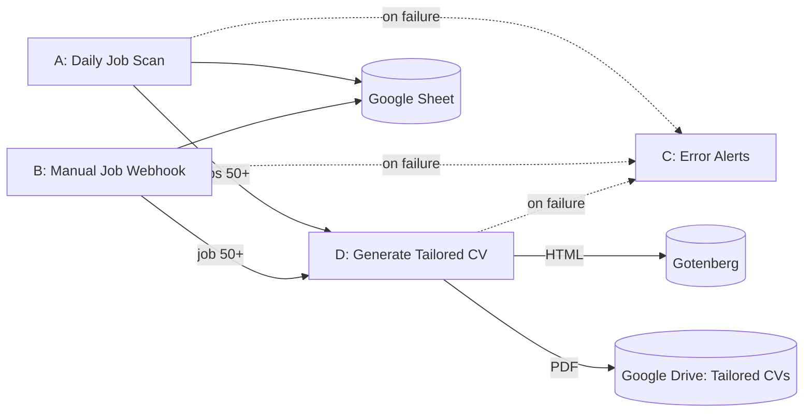
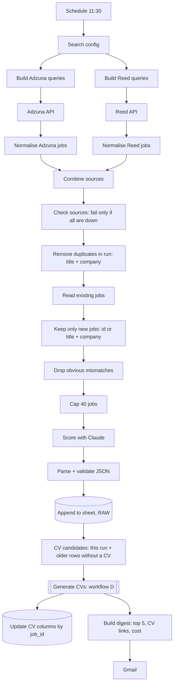
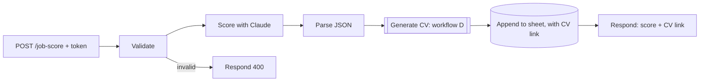
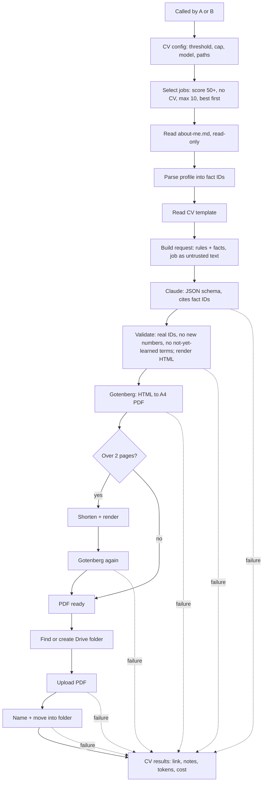
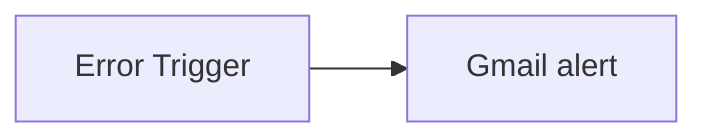

# Architecture

Four n8n workflows, plus Gotenberg for PDFs, all in one Docker Compose setup.

## Workflow A: Daily Job Scan

## Workflow B: Manual Job Webhook

## Workflow D: Generate Tailored CV (sub-workflow)

Every failure path joins one Merge node, so each selected job gets exactly one result: a CV link, or `CV failed (attempt n) at <step>: <reason>`, which is retried on the next run.

## Workflow C: Error Alerts

## Containers

| Service | Image | Network | Notes |
|---|---|---|---|
| n8n | `n8nio/n8n:2.48.5` | `127.0.0.1:5678` only | Read-only mounts: `PRIVATE_DIR` (profile) and `templates/`. File access limited to those two. |
| gotenberg | `gotenberg/gotenberg:8.40.0` | internal only | JavaScript disabled. Reached at `http://gotenberg:3000`. |
